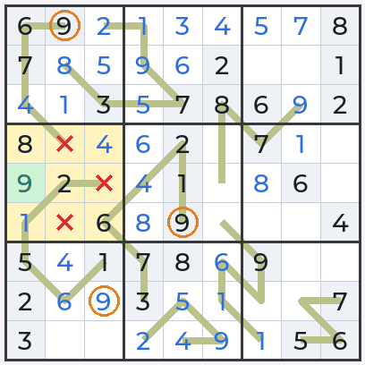

<!-- Written by tools/walkthrough.py weak-palindrome: edit the script, not this page. -->
# Weak Palindrome, step 32: the 9 in box 4

**Step 32 of 50** · [← Step 31](step-31.md) · [All steps](../weak-palindrome.md#the-whole-puzzle-step-by-step) · [Step 33 →](step-33.md)

Box 4 needs a 9. r4c2: column 2 has one (r1c2). r5c3: column 3 has one (r8c3). r6c2: row 6 has one (r6c5). Only **r5c1** is left: **r5c1 = 9**.

**Step 32 of 50** · [← Step 31](step-31.md) · [All steps](../weak-palindrome.md#the-whole-puzzle-step-by-step) · [Step 33 →](step-33.md)
