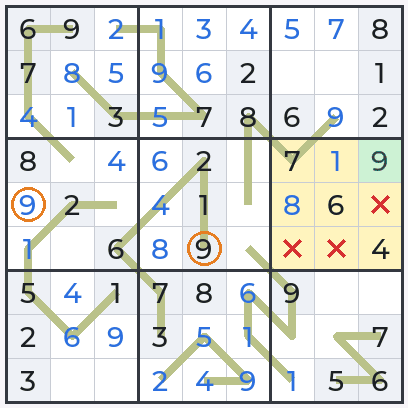

<!-- Written by tools/walkthrough.py weak-palindrome: edit the script, not this page. -->
# Weak Palindrome, step 33: the 9 in box 6

**Step 33 of 50** · [← Step 32](step-32.md) · [All steps](../weak-palindrome.md#the-whole-puzzle-step-by-step) · [Step 34 →](step-34.md)

Box 6 needs a 9. r5c9: row 5 has one (r5c1). r6c7 and r6c8: row 6 has one (r6c5). Only **r4c9** is left: **r4c9 = 9**.

**Step 33 of 50** · [← Step 32](step-32.md) · [All steps](../weak-palindrome.md#the-whole-puzzle-step-by-step) · [Step 34 →](step-34.md)
