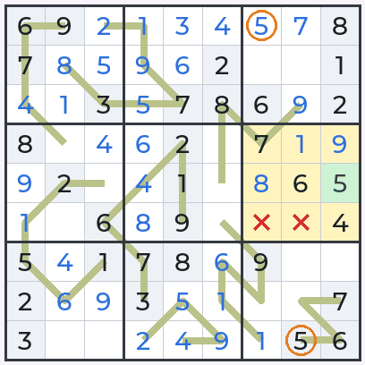

<!-- Written by tools/walkthrough.py weak-palindrome: edit the script, not this page. -->
# Weak Palindrome, step 34: the 5 in box 6

**Step 34 of 50** · [← Step 33](step-33.md) · [All steps](../weak-palindrome.md#the-whole-puzzle-step-by-step) · [Step 35 →](step-35.md)

Box 6 needs a 5. r6c7: column 7 has one (r1c7). r6c8: column 8 has one (r9c8). Only **r5c9** is left: **r5c9 = 5**.

**Step 34 of 50** · [← Step 33](step-33.md) · [All steps](../weak-palindrome.md#the-whole-puzzle-step-by-step) · [Step 35 →](step-35.md)
