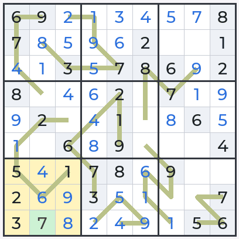

<!-- Written by tools/walkthrough.py weak-palindrome: edit the script, not this page. -->
# Weak Palindrome, step 36: the 7 in box 7

**Step 36 of 50** · [← Step 35](step-35.md) · [All steps](../weak-palindrome.md#the-whole-puzzle-step-by-step) · [Step 37 →](step-37.md)

Box 7 needs a 7, and r9c2 is its last empty cell: **r9c2 = 7**.

**Step 36 of 50** · [← Step 35](step-35.md) · [All steps](../weak-palindrome.md#the-whole-puzzle-step-by-step) · [Step 37 →](step-37.md)
