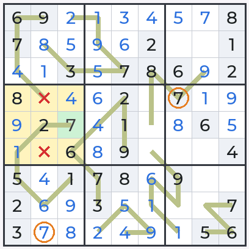

<!-- Written by tools/walkthrough.py weak-palindrome: edit the script, not this page. -->
# Weak Palindrome, step 37: the 7 in box 4

**Step 37 of 50** · [← Step 36](step-36.md) · [All steps](../weak-palindrome.md#the-whole-puzzle-step-by-step) · [Step 38 →](step-38.md)

Box 4 needs a 7. r4c2: row 4 has one (r4c7). r6c2: column 2 has one (r9c2). Only **r5c3** is left: **r5c3 = 7**.

**Step 37 of 50** · [← Step 36](step-36.md) · [All steps](../weak-palindrome.md#the-whole-puzzle-step-by-step) · [Step 38 →](step-38.md)
