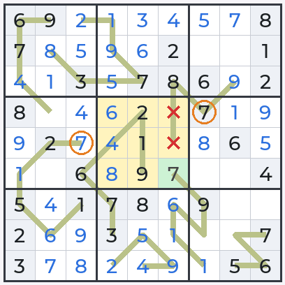

<!-- Written by tools/walkthrough.py weak-palindrome: edit the script, not this page. -->
# Weak Palindrome, step 38: the 7 in box 5

**Step 38 of 50** · [← Step 37](step-37.md) · [All steps](../weak-palindrome.md#the-whole-puzzle-step-by-step) · [Step 39 →](step-39.md)

Box 5 needs a 7. r4c6: row 4 has one (r4c7). r5c6: row 5 has one (r5c3). Only **r6c6** is left: **r6c6 = 7**.

**Step 38 of 50** · [← Step 37](step-37.md) · [All steps](../weak-palindrome.md#the-whole-puzzle-step-by-step) · [Step 39 →](step-39.md)
