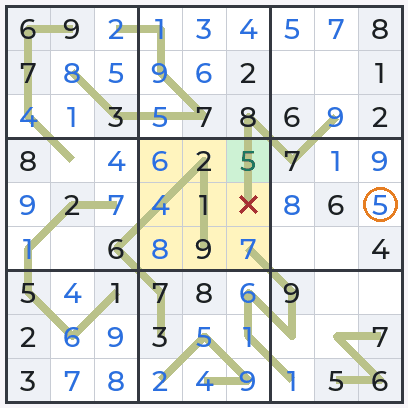

<!-- Written by tools/walkthrough.py weak-palindrome: edit the script, not this page. -->
# Weak Palindrome, step 39: the 5 in box 5

**Step 39 of 50** · [← Step 38](step-38.md) · [All steps](../weak-palindrome.md#the-whole-puzzle-step-by-step) · [Step 40 →](step-40.md)

Box 5 needs a 5. r5c6: row 5 has one (r5c9). Only **r4c6** is left: **r4c6 = 5**.

**Step 39 of 50** · [← Step 38](step-38.md) · [All steps](../weak-palindrome.md#the-whole-puzzle-step-by-step) · [Step 40 →](step-40.md)
