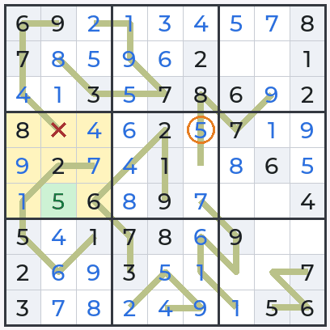

<!-- Written by tools/walkthrough.py weak-palindrome: edit the script, not this page. -->
# Weak Palindrome, step 40: the 5 in box 4

**Step 40 of 50** · [← Step 39](step-39.md) · [All steps](../weak-palindrome.md#the-whole-puzzle-step-by-step) · [Step 41 →](step-41.md)

Box 4 needs a 5. r4c2: row 4 has one (r4c6). Only **r6c2** is left: **r6c2 = 5**.

**Step 40 of 50** · [← Step 39](step-39.md) · [All steps](../weak-palindrome.md#the-whole-puzzle-step-by-step) · [Step 41 →](step-41.md)
