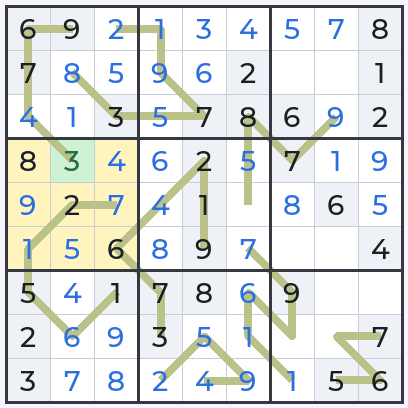

<!-- Written by tools/walkthrough.py weak-palindrome: edit the script, not this page. -->
# Weak Palindrome, step 41: the 3 in box 4

**Step 41 of 50** · [← Step 40](step-40.md) · [All steps](../weak-palindrome.md#the-whole-puzzle-step-by-step) · [Step 42 →](step-42.md)

Box 4 needs a 3, and r4c2 is its last empty cell: **r4c2 = 3**.

**Step 41 of 50** · [← Step 40](step-40.md) · [All steps](../weak-palindrome.md#the-whole-puzzle-step-by-step) · [Step 42 →](step-42.md)
