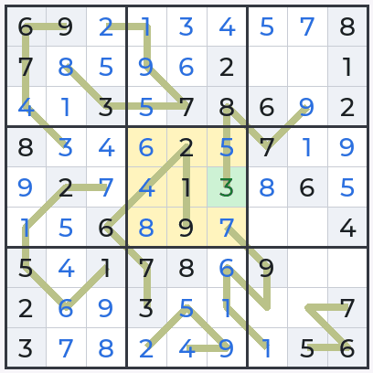

<!-- Written by tools/walkthrough.py weak-palindrome: edit the script, not this page. -->
# Weak Palindrome, step 42: the 3 in box 5

**Step 42 of 50** · [← Step 41](step-41.md) · [All steps](../weak-palindrome.md#the-whole-puzzle-step-by-step) · [Step 43 →](step-43.md)

Box 5 needs a 3, and r5c6 is its last empty cell: **r5c6 = 3**.

**Step 42 of 50** · [← Step 41](step-41.md) · [All steps](../weak-palindrome.md#the-whole-puzzle-step-by-step) · [Step 43 →](step-43.md)
