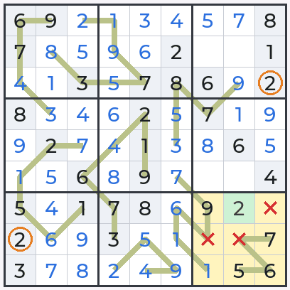

<!-- Written by tools/walkthrough.py weak-palindrome: edit the script, not this page. -->
# Weak Palindrome, step 43: the 2 in box 9

**Step 43 of 50** · [← Step 42](step-42.md) · [All steps](../weak-palindrome.md#the-whole-puzzle-step-by-step) · [Step 44 →](step-44.md)

Box 9 needs a 2. r7c9: column 9 has one (r3c9). r8c7 and r8c8: row 8 has one (r8c1). Only **r7c8** is left: **r7c8 = 2**.

**Step 43 of 50** · [← Step 42](step-42.md) · [All steps](../weak-palindrome.md#the-whole-puzzle-step-by-step) · [Step 44 →](step-44.md)
