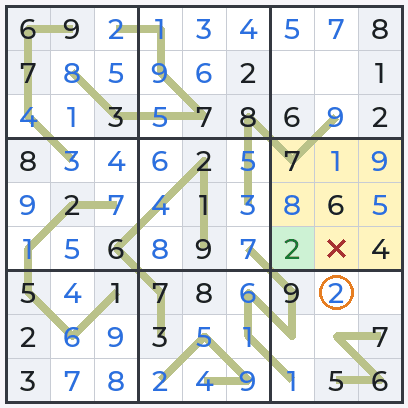

<!-- Written by tools/walkthrough.py weak-palindrome: edit the script, not this page. -->
# Weak Palindrome, step 44: the 2 in box 6

**Step 44 of 50** · [← Step 43](step-43.md) · [All steps](../weak-palindrome.md#the-whole-puzzle-step-by-step) · [Step 45 →](step-45.md)

Box 6 needs a 2. r6c8: column 8 has one (r7c8). Only **r6c7** is left: **r6c7 = 2**.

**Step 44 of 50** · [← Step 43](step-43.md) · [All steps](../weak-palindrome.md#the-whole-puzzle-step-by-step) · [Step 45 →](step-45.md)
