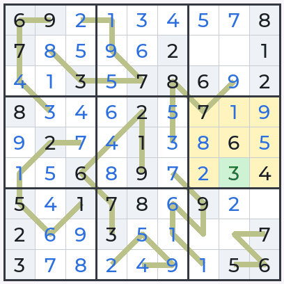

<!-- Written by tools/walkthrough.py weak-palindrome: edit the script, not this page. -->
# Weak Palindrome, step 45: the 3 in box 6

**Step 45 of 50** · [← Step 44](step-44.md) · [All steps](../weak-palindrome.md#the-whole-puzzle-step-by-step) · [Step 46 →](step-46.md)

Box 6 needs a 3, and r6c8 is its last empty cell: **r6c8 = 3**.

**Step 45 of 50** · [← Step 44](step-44.md) · [All steps](../weak-palindrome.md#the-whole-puzzle-step-by-step) · [Step 46 →](step-46.md)
