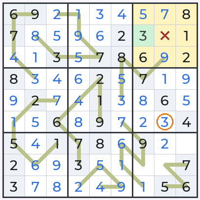

<!-- Written by tools/walkthrough.py weak-palindrome: edit the script, not this page. -->
# Weak Palindrome, step 46: the 3 in box 3

**Step 46 of 50** · [← Step 45](step-45.md) · [All steps](../weak-palindrome.md#the-whole-puzzle-step-by-step) · [Step 47 →](step-47.md)

Box 3 needs a 3. r2c8: column 8 has one (r6c8). Only **r2c7** is left: **r2c7 = 3**.

**Step 46 of 50** · [← Step 45](step-45.md) · [All steps](../weak-palindrome.md#the-whole-puzzle-step-by-step) · [Step 47 →](step-47.md)
