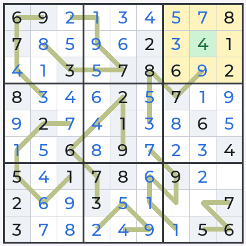

<!-- Written by tools/walkthrough.py weak-palindrome: edit the script, not this page. -->
# Weak Palindrome, step 47: the 4 in box 3

**Step 47 of 50** · [← Step 46](step-46.md) · [All steps](../weak-palindrome.md#the-whole-puzzle-step-by-step) · [Step 48 →](step-48.md)

Box 3 needs a 4, and r2c8 is its last empty cell: **r2c8 = 4**.

**Step 47 of 50** · [← Step 46](step-46.md) · [All steps](../weak-palindrome.md#the-whole-puzzle-step-by-step) · [Step 48 →](step-48.md)
