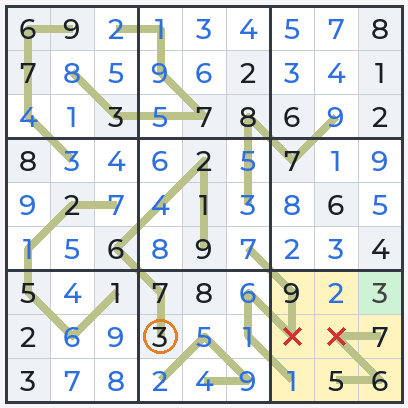

<!-- Written by tools/walkthrough.py weak-palindrome: edit the script, not this page. -->
# Weak Palindrome, step 48: the 3 in box 9

**Step 48 of 50** · [← Step 47](step-47.md) · [All steps](../weak-palindrome.md#the-whole-puzzle-step-by-step) · [Step 49 →](step-49.md)

Box 9 needs a 3. r8c7 and r8c8: row 8 has one (r8c4). Only **r7c9** is left: **r7c9 = 3**.

**Step 48 of 50** · [← Step 47](step-47.md) · [All steps](../weak-palindrome.md#the-whole-puzzle-step-by-step) · [Step 49 →](step-49.md)
