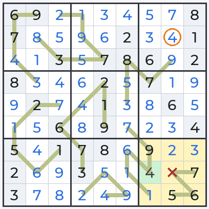

<!-- Written by tools/walkthrough.py weak-palindrome: edit the script, not this page. -->
# Weak Palindrome, step 49: the 4 in box 9

**Step 49 of 50** · [← Step 48](step-48.md) · [All steps](../weak-palindrome.md#the-whole-puzzle-step-by-step) · [Step 50 →](step-50.md)

Box 9 needs a 4. r8c8: column 8 has one (r2c8). Only **r8c7** is left: **r8c7 = 4**.

**Step 49 of 50** · [← Step 48](step-48.md) · [All steps](../weak-palindrome.md#the-whole-puzzle-step-by-step) · [Step 50 →](step-50.md)
