# X-Sudoku

[← All variants](README.md) · [Puzzles](../features-puzzles.md) · [How to play](../how-to-play.md)

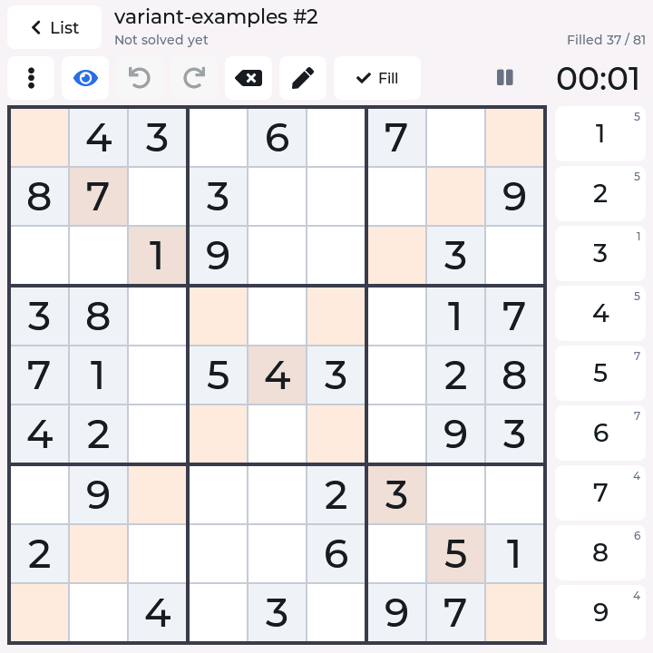

## The rules

[Classic](classic.md) rules, and both long **diagonals** must also hold 1 to 9, each once: the **main diagonal** from the top-left corner to the bottom-right, and the **anti-diagonal** from the top-right corner to the bottom-left. The centre cell is on both.

## On the board

- The 17 diagonal cells have a warm tint.
- A digit that repeats on a diagonal turns red like any other repeat, and completing a diagonal sparkles.
- Hints name the diagonals: "Look at the top-left diagonal" (the main one, starting in the top-left corner) or "the top-right diagonal".
- **Puzzles → ⋮ → New puzzle → X-Sudoku**; it's also Wednesday's daily puzzle.

## How to solve it

- Treat each diagonal as a tenth "row": a hidden single can be on a diagonal ("the only place for 5 on the main diagonal").
- A diagonal cell has more neighbours than a normal cell (its row, column, box and diagonal), so diagonal cells often run out of candidates first: look there for naked singles.
- The centre cell sees both diagonals: 32 other cells instead of 20.

## Worked example

**variant-examples #2**, X-Sudoku Easy (see [Classic](classic.md#worked-example-the-whole-puzzle) for how to import the examples; cells are written r*row*c*column*).

**Step 1: r2c8, using the anti-diagonal.** r2c8 is on the anti-diagonal (it runs r1c9, r2c8, r3c7, r4c6, r5c5, r6c4, r7c3, r8c2, r9c1). Which digits can it take?

- Row 2 has 8, 7, 3 and 9.
- Column 8 has 3, 1, 2, 9, 5 and 7.
- That leaves 4 and 6. By the Classic rules alone that's as far as it goes.
- But r5c5, on the same anti-diagonal, is a 4.

So **r2c8 = 6**.

**Step 2: r6c6, using the main diagonal.** r6c6 is on the main diagonal (r1c1, r2c2, ..., r9c9), which already has 7 (r2c2), 1 (r3c3), 4 (r5c5), 3 (r7c7) and 5 (r8c8). Add row 6 (4, 2, 9, 3), column 6 (3, 2, 6) and box 5 (5, 4, 3): every digit but 8 is there. **r6c6 = 8**.

**Step 3: the 6 in column 4.** Column 4 needs a 6:

- r1c4: row 1 has a 6 (r1c5).
- r6c4: it's on the anti-diagonal, which now has the 6 from step 1 (r2c8).
- r7c4, r9c4: box 8 has a 6 (r8c6).
- r8c4: row 8 has that same 6.
- r2c4, r3c4 and r5c4 are filled (3, 9, 5).

Only **r4c4** is left: **r4c4 = 6**. Without the diagonal rule, r6c4 would still have been a place for it.

## The whole puzzle, step by step

<!-- walkthrough -->
<!-- Written by tools/walkthrough.py x-sudoku: edit the script, not this part. -->

The whole puzzle, from the start to the last cell: 44 steps, each one a single (one place left for a digit, or one digit left for a cell), taken in the order a box's single comes first, so not quite the order of the worked example above. In each picture, the unit the step looks at is tinted yellow (for a cell with one digit left: its row, column and box), the new digit is on green, the digits that rule cells out have an **orange ring**, and the empty cells they rule out a **red cross**. Givens are on grey, digits from earlier steps in blue.

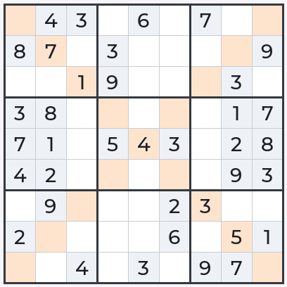

#### Step 1: the 2 in box 1

Box 1 needs a 2. r1c1 and r3c1: column 1 has one (r8c1). r3c2: column 2 has one (r6c2). Only **r2c3** is left: **r2c3 = 2**.

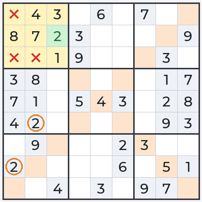

#### Step 2: the 9 in box 1

Box 1 needs a 9. r3c1 and r3c2: row 3 has one (r3c4). Only **r1c1** is left: **r1c1 = 9**.

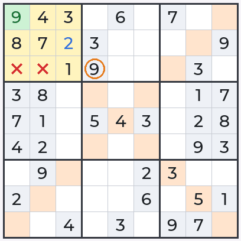

#### Step 3: the 1 in box 3

Box 3 needs a 1. r1c8 and r2c8: column 8 has one (r4c8). r1c9: column 9 has one (r8c9). r3c7 and r3c9: row 3 has one (r3c3). Only **r2c7** is left: **r2c7 = 1**.

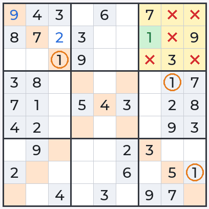

#### Step 4: the 4 in box 3

Box 3 needs a 4. r1c8 and r1c9: row 1 has one (r1c2). r2c8 and r3c7: the anti-diagonal has one (r5c5). Only **r3c9** is left: **r3c9 = 4**.

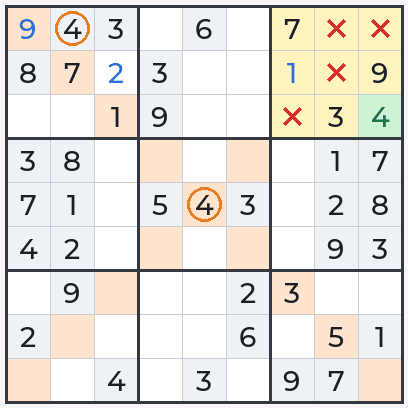

#### Step 5: the 4 in box 2

Box 2 needs a 4. r1c4 and r1c6: row 1 has one (r1c2). r2c5: column 5 has one (r5c5). r3c5 and r3c6: row 3 has one (r3c9). Only **r2c6** is left: **r2c6 = 4**.

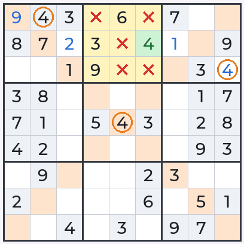

#### Step 6: the 4 in box 6

Box 6 needs a 4. r5c7: row 5 has one (r5c5). r6c7: row 6 has one (r6c1). Only **r4c7** is left: **r4c7 = 4**.

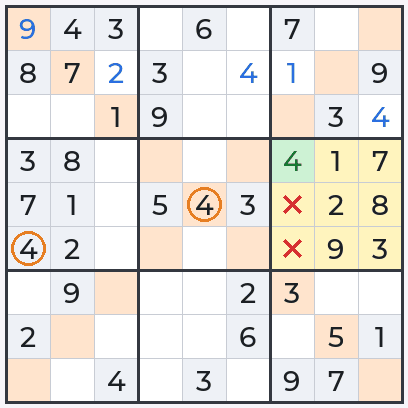

#### Step 7: the 5 in box 6

Box 6 needs a 5. r5c7: row 5 has one (r5c4). Only **r6c7** is left: **r6c7 = 5**.

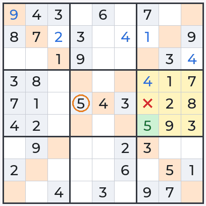

#### Step 8: the 5 in box 3

Box 3 needs a 5. r1c8 and r2c8: column 8 has one (r8c8). r3c7: column 7 has one (r6c7). Only **r1c9** is left: **r1c9 = 5**.

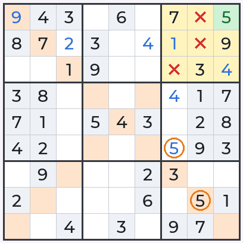

#### Step 9: the 2 in box 3

Box 3 needs a 2. r1c8: column 8 has one (r5c8). r2c8: row 2 has one (r2c3). Only **r3c7** is left: **r3c7 = 2**.

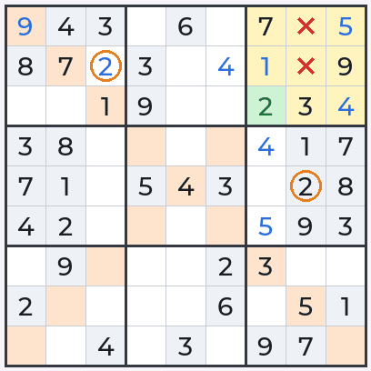

#### Step 10: the 2 in box 2

Box 2 needs a 2. r1c6: column 6 has one (r7c6). r2c5: row 2 has one (r2c3). r3c5 and r3c6: row 3 has one (r3c7). Only **r1c4** is left: **r1c4 = 2**.

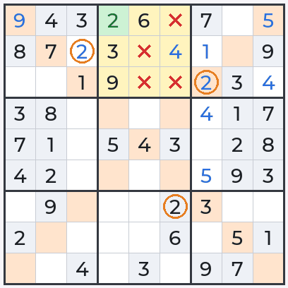

#### Step 11: the 1 in box 2

Box 2 needs a 1. r2c5: row 2 has one (r2c7). r3c5 and r3c6: row 3 has one (r3c3). Only **r1c6** is left: **r1c6 = 1**.

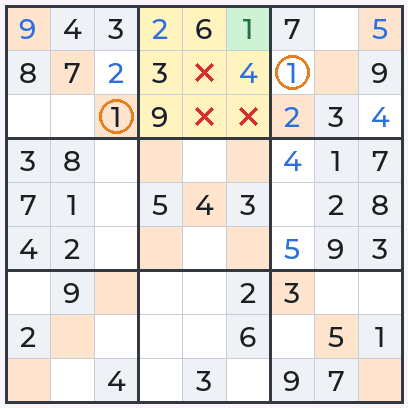

#### Step 12: the 6 in box 3

Box 3 needs a 6. r1c8: row 1 has one (r1c5). Only **r2c8** is left: **r2c8 = 6**.

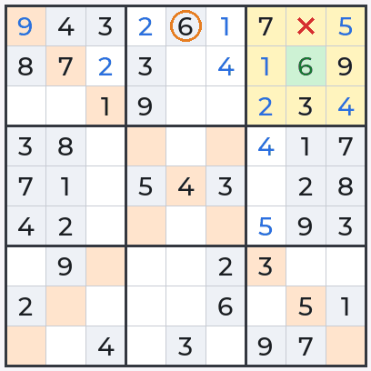

#### Step 13: the 8 in box 3

Box 3 needs an 8, and r1c8 is its last empty cell: **r1c8 = 8**.

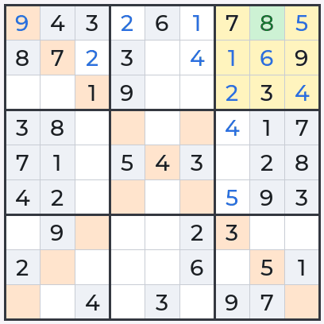

#### Step 14: the 5 in box 4

Box 4 needs a 5. r5c3: row 5 has one (r5c4). r6c3: row 6 has one (r6c7). Only **r4c3** is left: **r4c3 = 5**.

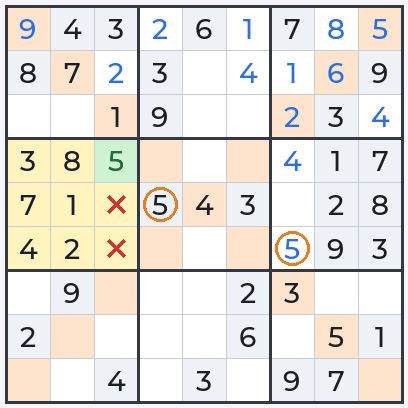

#### Step 15: the 9 in box 4

Box 4 needs a 9. r6c3: row 6 has one (r6c8). Only **r5c3** is left: **r5c3 = 9**.

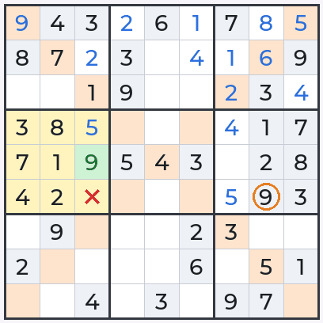

#### Step 16: the 6 in box 4

Box 4 needs a 6, and r6c3 is its last empty cell: **r6c3 = 6**.

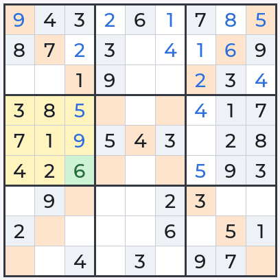

#### Step 17: the 2 in box 5

Box 5 needs a 2. r4c4: column 4 has one (r1c4). r4c6: column 6 has one (r7c6). r6c4, r6c5 and r6c6: row 6 has one (r6c2). Only **r4c5** is left: **r4c5 = 2**.

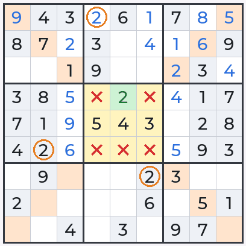

#### Step 18: the 6 in box 5

Box 5 needs a 6. r4c6: column 6 has one (r8c6). r6c4, r6c5 and r6c6: row 6 has one (r6c3). Only **r4c4** is left: **r4c4 = 6**.

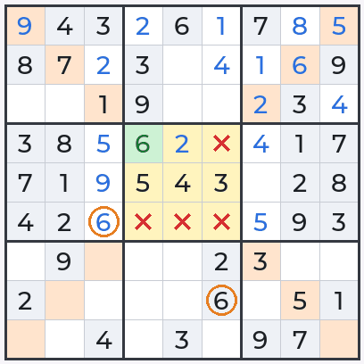

#### Step 19: the 9 in box 5

Box 5 needs a 9. r6c4, r6c5 and r6c6: row 6 has one (r6c8). Only **r4c6** is left: **r4c6 = 9**.

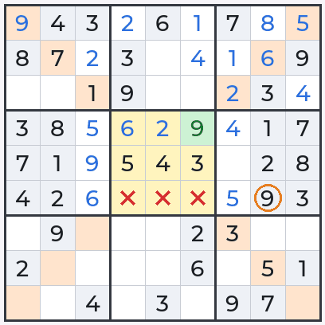

#### Step 20: the 6 in box 6

Box 6 needs a 6, and r5c7 is its last empty cell: **r5c7 = 6**.

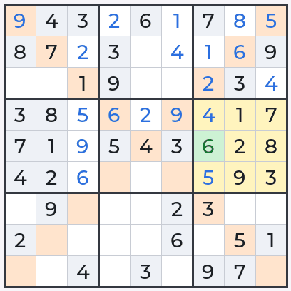

#### Step 21: the 3 in box 7

Box 7 needs a 3. r7c1 and r7c3: row 7 has one (r7c7). r8c3: column 3 has one (r1c3). r9c1 and r9c2: row 9 has one (r9c5). Only **r8c2** is left: **r8c2 = 3**.

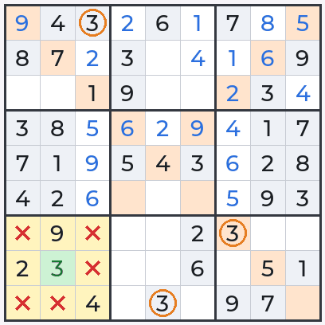

#### Step 22: the 9 in box 8

Box 8 needs a 9. r7c4 and r7c5: row 7 has one (r7c2). r8c4: column 4 has one (r3c4). r9c4 and r9c6: row 9 has one (r9c7). Only **r8c5** is left: **r8c5 = 9**.

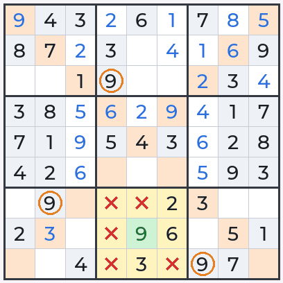

#### Step 23: the 2 in box 9

Box 9 needs a 2. r7c8 and r7c9: row 7 has one (r7c6). r8c7: row 8 has one (r8c1). Only **r9c9** is left: **r9c9 = 2**.

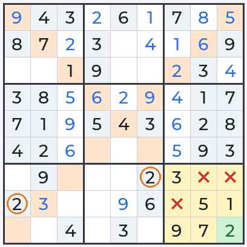

#### Step 24: the 4 in box 9

Box 9 needs a 4. r7c9: column 9 has one (r3c9). r8c7: column 7 has one (r4c7). Only **r7c8** is left: **r7c8 = 4**.

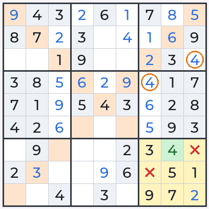

#### Step 25: the 4 in box 8

Box 8 needs a 4. r7c4 and r7c5: row 7 has one (r7c8). r9c4 and r9c6: row 9 has one (r9c3). Only **r8c4** is left: **r8c4 = 4**.

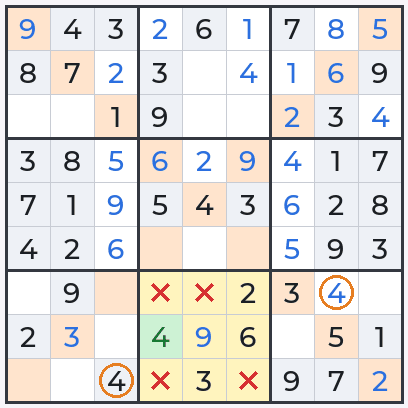

#### Step 26: the 6 in box 9

Box 9 needs a 6. r8c7: row 8 has one (r8c6). Only **r7c9** is left: **r7c9 = 6**.

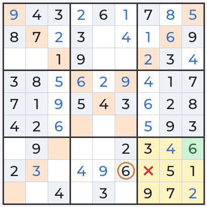

#### Step 27: the 6 in box 7

Box 7 needs a 6. r7c1 and r7c3: row 7 has one (r7c9). r8c3: row 8 has one (r8c6). r9c1: the anti-diagonal has one (r2c8). Only **r9c2** is left: **r9c2 = 6**.

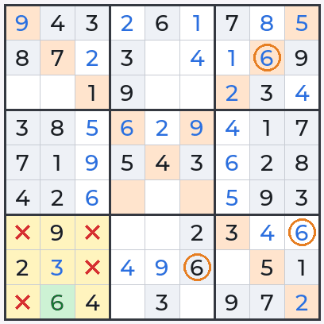

#### Step 28: the 6 in box 1

Box 1 needs a 6. r3c2: column 2 has one (r9c2). Only **r3c1** is left: **r3c1 = 6**.

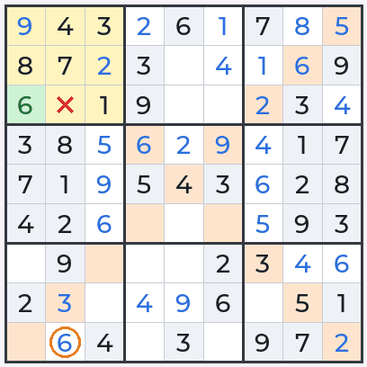

#### Step 29: the 5 in box 1

Box 1 needs a 5, and r3c2 is its last empty cell: **r3c2 = 5**.

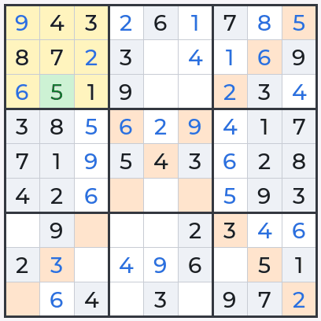

#### Step 30: the 5 in box 2

Box 2 needs a 5. r3c5 and r3c6: row 3 has one (r3c2). Only **r2c5** is left: **r2c5 = 5**.

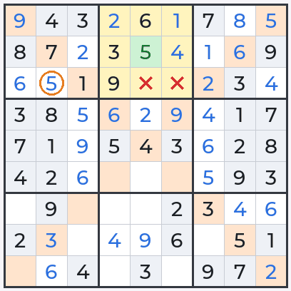

#### Step 31: the 5 in box 7

Box 7 needs a 5. r7c3: column 3 has one (r4c3). r8c3: row 8 has one (r8c8). r9c1: the anti-diagonal has one (r1c9). Only **r7c1** is left: **r7c1 = 5**.

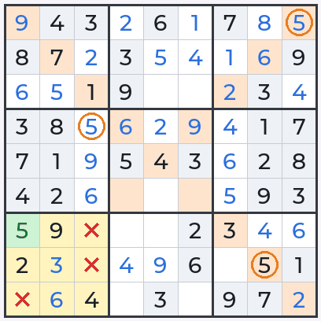

#### Step 32: the 1 in box 7

Box 7 needs a 1. r7c3: column 3 has one (r3c3). r8c3: row 8 has one (r8c9). Only **r9c1** is left: **r9c1 = 1**.

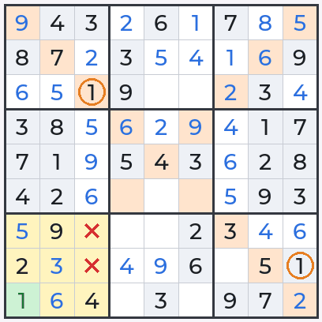

#### Step 33: the 1 in box 5

Box 5 needs a 1. r6c4: the anti-diagonal has one (r9c1). r6c6: column 6 has one (r1c6). Only **r6c5** is left: **r6c5 = 1**.

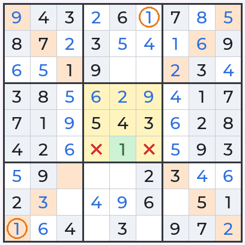

#### Step 34: the 7 in box 5

Box 5 needs a 7. r6c6: the main diagonal has one (r2c2). Only **r6c4** is left: **r6c4 = 7**.

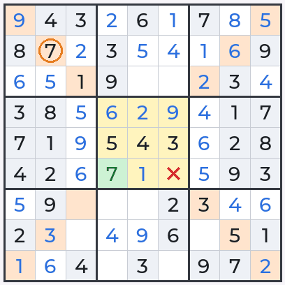

#### Step 35: the 8 in box 5

Box 5 needs an 8, and r6c6 is its last empty cell: **r6c6 = 8**.

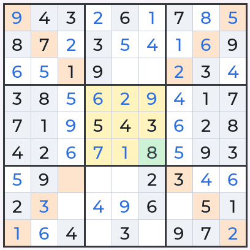

#### Step 36: the 8 in box 2

Box 2 needs an 8. r3c6: column 6 has one (r6c6). Only **r3c5** is left: **r3c5 = 8**.

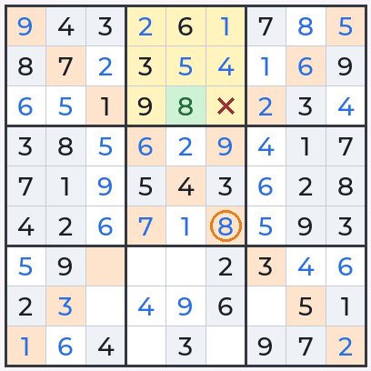

#### Step 37: the 7 in box 2

Box 2 needs a 7, and r3c6 is its last empty cell: **r3c6 = 7**.

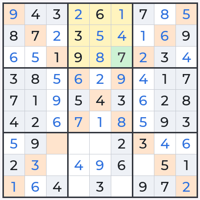

#### Step 38: the 7 in box 7

Box 7 needs a 7. r7c3: the anti-diagonal has one (r6c4). Only **r8c3** is left: **r8c3 = 7**.

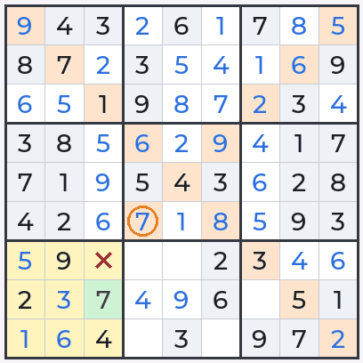

#### Step 39: the 8 in box 7

Box 7 needs an 8, and r7c3 is its last empty cell: **r7c3 = 8**.

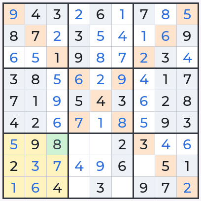

#### Step 40: the 1 in box 8

Box 8 needs a 1. r7c5: column 5 has one (r6c5). r9c4 and r9c6: row 9 has one (r9c1). Only **r7c4** is left: **r7c4 = 1**.

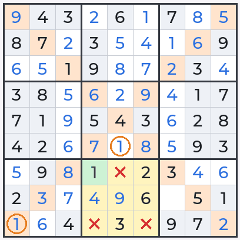

#### Step 41: the 5 in box 8

Box 8 needs a 5. r7c5: row 7 has one (r7c1). r9c4: column 4 has one (r5c4). Only **r9c6** is left: **r9c6 = 5**.

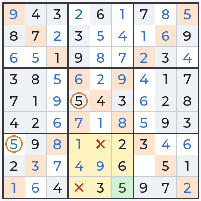

#### Step 42: the 7 in box 8

Box 8 needs a 7. r9c4: row 9 has one (r9c8). Only **r7c5** is left: **r7c5 = 7**.

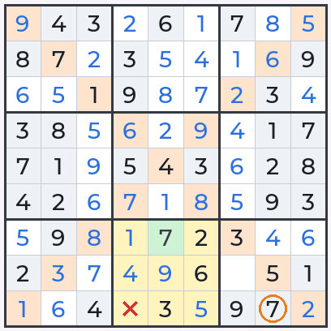

#### Step 43: the 8 in box 8

Box 8 needs an 8, and r9c4 is its last empty cell: **r9c4 = 8**.

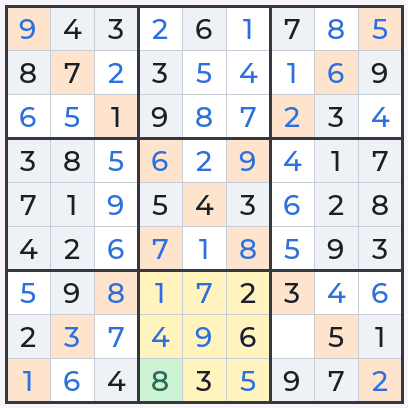

#### Step 44: the 8 in box 9

Box 9 needs an 8, and r8c7 is its last empty cell: **r8c7 = 8**.

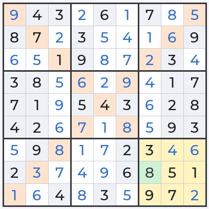

Solved.

<!-- /walkthrough -->
