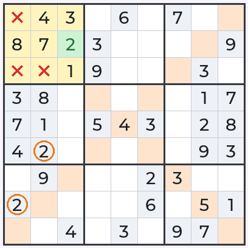

<!-- Written by tools/walkthrough.py x-sudoku: edit the script, not this page. -->
# X-Sudoku, step 1: the 2 in box 1

**Step 1 of 44** · [← The start](../x-sudoku.md#the-whole-puzzle-step-by-step) · [All steps](../x-sudoku.md#the-whole-puzzle-step-by-step) · [Step 2 →](step-02.md)

Box 1 needs a 2. r1c1 and r3c1: column 1 has one (r8c1). r3c2: column 2 has one (r6c2). Only **r2c3** is left: **r2c3 = 2**.

**Step 1 of 44** · [← The start](../x-sudoku.md#the-whole-puzzle-step-by-step) · [All steps](../x-sudoku.md#the-whole-puzzle-step-by-step) · [Step 2 →](step-02.md)
