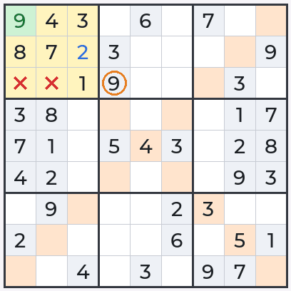

<!-- Written by tools/walkthrough.py x-sudoku: edit the script, not this page. -->
# X-Sudoku, step 2: the 9 in box 1

**Step 2 of 44** · [← Step 1](step-01.md) · [All steps](../x-sudoku.md#the-whole-puzzle-step-by-step) · [Step 3 →](step-03.md)

Box 1 needs a 9. r3c1 and r3c2: row 3 has one (r3c4). Only **r1c1** is left: **r1c1 = 9**.

**Step 2 of 44** · [← Step 1](step-01.md) · [All steps](../x-sudoku.md#the-whole-puzzle-step-by-step) · [Step 3 →](step-03.md)
