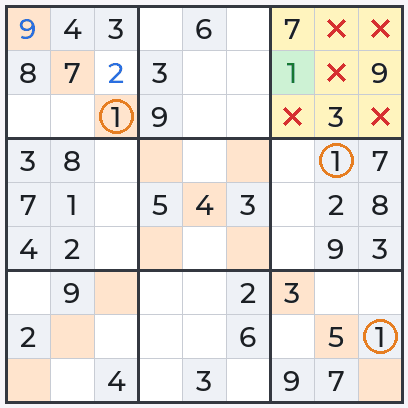

<!-- Written by tools/walkthrough.py x-sudoku: edit the script, not this page. -->
# X-Sudoku, step 3: the 1 in box 3

**Step 3 of 44** · [← Step 2](step-02.md) · [All steps](../x-sudoku.md#the-whole-puzzle-step-by-step) · [Step 4 →](step-04.md)

Box 3 needs a 1. r1c8 and r2c8: column 8 has one (r4c8). r1c9: column 9 has one (r8c9). r3c7 and r3c9: row 3 has one (r3c3). Only **r2c7** is left: **r2c7 = 1**.

**Step 3 of 44** · [← Step 2](step-02.md) · [All steps](../x-sudoku.md#the-whole-puzzle-step-by-step) · [Step 4 →](step-04.md)
