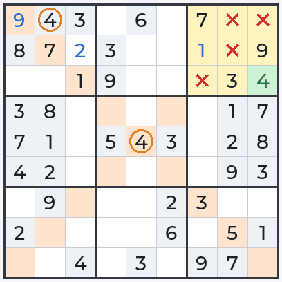

<!-- Written by tools/walkthrough.py x-sudoku: edit the script, not this page. -->
# X-Sudoku, step 4: the 4 in box 3

**Step 4 of 44** · [← Step 3](step-03.md) · [All steps](../x-sudoku.md#the-whole-puzzle-step-by-step) · [Step 5 →](step-05.md)

Box 3 needs a 4. r1c8 and r1c9: row 1 has one (r1c2). r2c8 and r3c7: the anti-diagonal has one (r5c5). Only **r3c9** is left: **r3c9 = 4**.

**Step 4 of 44** · [← Step 3](step-03.md) · [All steps](../x-sudoku.md#the-whole-puzzle-step-by-step) · [Step 5 →](step-05.md)
