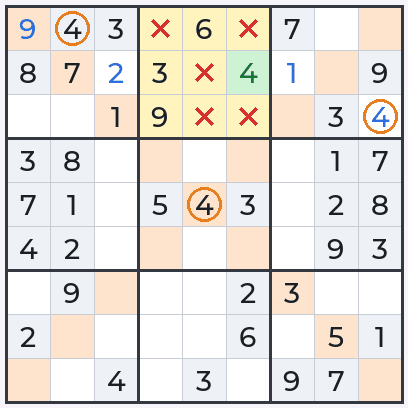

<!-- Written by tools/walkthrough.py x-sudoku: edit the script, not this page. -->
# X-Sudoku, step 5: the 4 in box 2

**Step 5 of 44** · [← Step 4](step-04.md) · [All steps](../x-sudoku.md#the-whole-puzzle-step-by-step) · [Step 6 →](step-06.md)

Box 2 needs a 4. r1c4 and r1c6: row 1 has one (r1c2). r2c5: column 5 has one (r5c5). r3c5 and r3c6: row 3 has one (r3c9). Only **r2c6** is left: **r2c6 = 4**.

**Step 5 of 44** · [← Step 4](step-04.md) · [All steps](../x-sudoku.md#the-whole-puzzle-step-by-step) · [Step 6 →](step-06.md)
