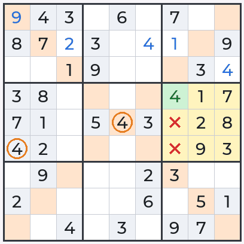

<!-- Written by tools/walkthrough.py x-sudoku: edit the script, not this page. -->
# X-Sudoku, step 6: the 4 in box 6

**Step 6 of 44** · [← Step 5](step-05.md) · [All steps](../x-sudoku.md#the-whole-puzzle-step-by-step) · [Step 7 →](step-07.md)

Box 6 needs a 4. r5c7: row 5 has one (r5c5). r6c7: row 6 has one (r6c1). Only **r4c7** is left: **r4c7 = 4**.

**Step 6 of 44** · [← Step 5](step-05.md) · [All steps](../x-sudoku.md#the-whole-puzzle-step-by-step) · [Step 7 →](step-07.md)
