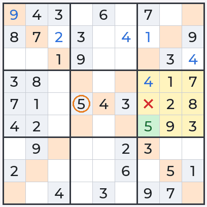

<!-- Written by tools/walkthrough.py x-sudoku: edit the script, not this page. -->
# X-Sudoku, step 7: the 5 in box 6

**Step 7 of 44** · [← Step 6](step-06.md) · [All steps](../x-sudoku.md#the-whole-puzzle-step-by-step) · [Step 8 →](step-08.md)

Box 6 needs a 5. r5c7: row 5 has one (r5c4). Only **r6c7** is left: **r6c7 = 5**.

**Step 7 of 44** · [← Step 6](step-06.md) · [All steps](../x-sudoku.md#the-whole-puzzle-step-by-step) · [Step 8 →](step-08.md)
