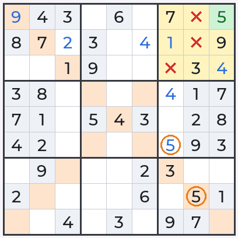

<!-- Written by tools/walkthrough.py x-sudoku: edit the script, not this page. -->
# X-Sudoku, step 8: the 5 in box 3

**Step 8 of 44** · [← Step 7](step-07.md) · [All steps](../x-sudoku.md#the-whole-puzzle-step-by-step) · [Step 9 →](step-09.md)

Box 3 needs a 5. r1c8 and r2c8: column 8 has one (r8c8). r3c7: column 7 has one (r6c7). Only **r1c9** is left: **r1c9 = 5**.

**Step 8 of 44** · [← Step 7](step-07.md) · [All steps](../x-sudoku.md#the-whole-puzzle-step-by-step) · [Step 9 →](step-09.md)
