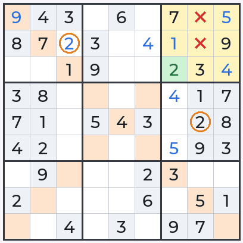

<!-- Written by tools/walkthrough.py x-sudoku: edit the script, not this page. -->
# X-Sudoku, step 9: the 2 in box 3

**Step 9 of 44** · [← Step 8](step-08.md) · [All steps](../x-sudoku.md#the-whole-puzzle-step-by-step) · [Step 10 →](step-10.md)

Box 3 needs a 2. r1c8: column 8 has one (r5c8). r2c8: row 2 has one (r2c3). Only **r3c7** is left: **r3c7 = 2**.

**Step 9 of 44** · [← Step 8](step-08.md) · [All steps](../x-sudoku.md#the-whole-puzzle-step-by-step) · [Step 10 →](step-10.md)
