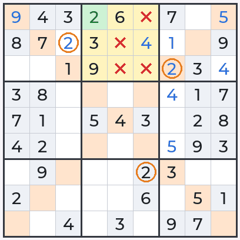

<!-- Written by tools/walkthrough.py x-sudoku: edit the script, not this page. -->
# X-Sudoku, step 10: the 2 in box 2

**Step 10 of 44** · [← Step 9](step-09.md) · [All steps](../x-sudoku.md#the-whole-puzzle-step-by-step) · [Step 11 →](step-11.md)

Box 2 needs a 2. r1c6: column 6 has one (r7c6). r2c5: row 2 has one (r2c3). r3c5 and r3c6: row 3 has one (r3c7). Only **r1c4** is left: **r1c4 = 2**.

**Step 10 of 44** · [← Step 9](step-09.md) · [All steps](../x-sudoku.md#the-whole-puzzle-step-by-step) · [Step 11 →](step-11.md)
