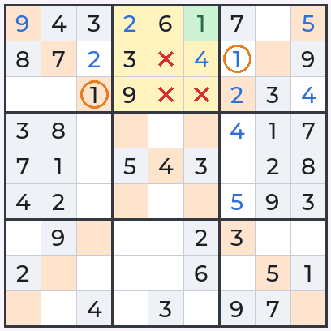

<!-- Written by tools/walkthrough.py x-sudoku: edit the script, not this page. -->
# X-Sudoku, step 11: the 1 in box 2

**Step 11 of 44** · [← Step 10](step-10.md) · [All steps](../x-sudoku.md#the-whole-puzzle-step-by-step) · [Step 12 →](step-12.md)

Box 2 needs a 1. r2c5: row 2 has one (r2c7). r3c5 and r3c6: row 3 has one (r3c3). Only **r1c6** is left: **r1c6 = 1**.

**Step 11 of 44** · [← Step 10](step-10.md) · [All steps](../x-sudoku.md#the-whole-puzzle-step-by-step) · [Step 12 →](step-12.md)
