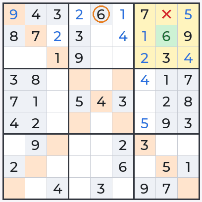

<!-- Written by tools/walkthrough.py x-sudoku: edit the script, not this page. -->
# X-Sudoku, step 12: the 6 in box 3

**Step 12 of 44** · [← Step 11](step-11.md) · [All steps](../x-sudoku.md#the-whole-puzzle-step-by-step) · [Step 13 →](step-13.md)

Box 3 needs a 6. r1c8: row 1 has one (r1c5). Only **r2c8** is left: **r2c8 = 6**.

**Step 12 of 44** · [← Step 11](step-11.md) · [All steps](../x-sudoku.md#the-whole-puzzle-step-by-step) · [Step 13 →](step-13.md)
