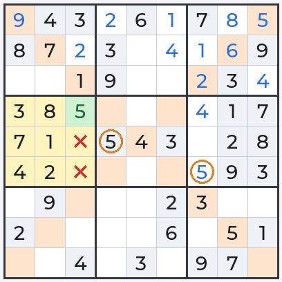

<!-- Written by tools/walkthrough.py x-sudoku: edit the script, not this page. -->
# X-Sudoku, step 14: the 5 in box 4

**Step 14 of 44** · [← Step 13](step-13.md) · [All steps](../x-sudoku.md#the-whole-puzzle-step-by-step) · [Step 15 →](step-15.md)

Box 4 needs a 5. r5c3: row 5 has one (r5c4). r6c3: row 6 has one (r6c7). Only **r4c3** is left: **r4c3 = 5**.

**Step 14 of 44** · [← Step 13](step-13.md) · [All steps](../x-sudoku.md#the-whole-puzzle-step-by-step) · [Step 15 →](step-15.md)
