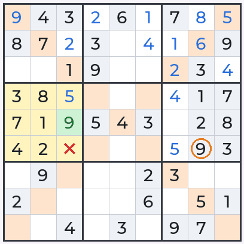

<!-- Written by tools/walkthrough.py x-sudoku: edit the script, not this page. -->
# X-Sudoku, step 15: the 9 in box 4

**Step 15 of 44** · [← Step 14](step-14.md) · [All steps](../x-sudoku.md#the-whole-puzzle-step-by-step) · [Step 16 →](step-16.md)

Box 4 needs a 9. r6c3: row 6 has one (r6c8). Only **r5c3** is left: **r5c3 = 9**.

**Step 15 of 44** · [← Step 14](step-14.md) · [All steps](../x-sudoku.md#the-whole-puzzle-step-by-step) · [Step 16 →](step-16.md)
