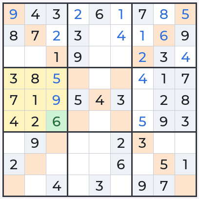

<!-- Written by tools/walkthrough.py x-sudoku: edit the script, not this page. -->
# X-Sudoku, step 16: the 6 in box 4

**Step 16 of 44** · [← Step 15](step-15.md) · [All steps](../x-sudoku.md#the-whole-puzzle-step-by-step) · [Step 17 →](step-17.md)

Box 4 needs a 6, and r6c3 is its last empty cell: **r6c3 = 6**.

**Step 16 of 44** · [← Step 15](step-15.md) · [All steps](../x-sudoku.md#the-whole-puzzle-step-by-step) · [Step 17 →](step-17.md)
