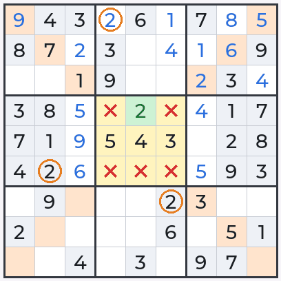

<!-- Written by tools/walkthrough.py x-sudoku: edit the script, not this page. -->
# X-Sudoku, step 17: the 2 in box 5

**Step 17 of 44** · [← Step 16](step-16.md) · [All steps](../x-sudoku.md#the-whole-puzzle-step-by-step) · [Step 18 →](step-18.md)

Box 5 needs a 2. r4c4: column 4 has one (r1c4). r4c6: column 6 has one (r7c6). r6c4, r6c5 and r6c6: row 6 has one (r6c2). Only **r4c5** is left: **r4c5 = 2**.

**Step 17 of 44** · [← Step 16](step-16.md) · [All steps](../x-sudoku.md#the-whole-puzzle-step-by-step) · [Step 18 →](step-18.md)
