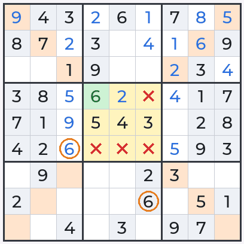

<!-- Written by tools/walkthrough.py x-sudoku: edit the script, not this page. -->
# X-Sudoku, step 18: the 6 in box 5

**Step 18 of 44** · [← Step 17](step-17.md) · [All steps](../x-sudoku.md#the-whole-puzzle-step-by-step) · [Step 19 →](step-19.md)

Box 5 needs a 6. r4c6: column 6 has one (r8c6). r6c4, r6c5 and r6c6: row 6 has one (r6c3). Only **r4c4** is left: **r4c4 = 6**.

**Step 18 of 44** · [← Step 17](step-17.md) · [All steps](../x-sudoku.md#the-whole-puzzle-step-by-step) · [Step 19 →](step-19.md)
