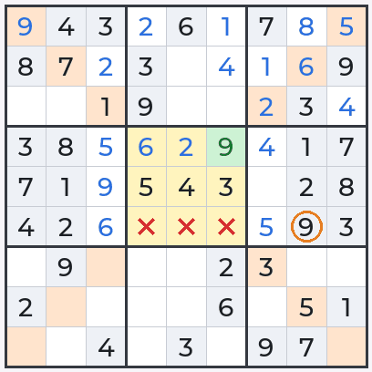

<!-- Written by tools/walkthrough.py x-sudoku: edit the script, not this page. -->
# X-Sudoku, step 19: the 9 in box 5

**Step 19 of 44** · [← Step 18](step-18.md) · [All steps](../x-sudoku.md#the-whole-puzzle-step-by-step) · [Step 20 →](step-20.md)

Box 5 needs a 9. r6c4, r6c5 and r6c6: row 6 has one (r6c8). Only **r4c6** is left: **r4c6 = 9**.

**Step 19 of 44** · [← Step 18](step-18.md) · [All steps](../x-sudoku.md#the-whole-puzzle-step-by-step) · [Step 20 →](step-20.md)
