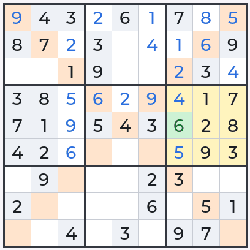

<!-- Written by tools/walkthrough.py x-sudoku: edit the script, not this page. -->
# X-Sudoku, step 20: the 6 in box 6

**Step 20 of 44** · [← Step 19](step-19.md) · [All steps](../x-sudoku.md#the-whole-puzzle-step-by-step) · [Step 21 →](step-21.md)

Box 6 needs a 6, and r5c7 is its last empty cell: **r5c7 = 6**.

**Step 20 of 44** · [← Step 19](step-19.md) · [All steps](../x-sudoku.md#the-whole-puzzle-step-by-step) · [Step 21 →](step-21.md)
