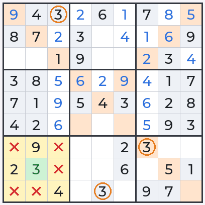

<!-- Written by tools/walkthrough.py x-sudoku: edit the script, not this page. -->
# X-Sudoku, step 21: the 3 in box 7

**Step 21 of 44** · [← Step 20](step-20.md) · [All steps](../x-sudoku.md#the-whole-puzzle-step-by-step) · [Step 22 →](step-22.md)

Box 7 needs a 3. r7c1 and r7c3: row 7 has one (r7c7). r8c3: column 3 has one (r1c3). r9c1 and r9c2: row 9 has one (r9c5). Only **r8c2** is left: **r8c2 = 3**.

**Step 21 of 44** · [← Step 20](step-20.md) · [All steps](../x-sudoku.md#the-whole-puzzle-step-by-step) · [Step 22 →](step-22.md)
