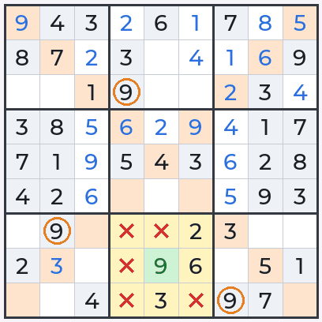

<!-- Written by tools/walkthrough.py x-sudoku: edit the script, not this page. -->
# X-Sudoku, step 22: the 9 in box 8

**Step 22 of 44** · [← Step 21](step-21.md) · [All steps](../x-sudoku.md#the-whole-puzzle-step-by-step) · [Step 23 →](step-23.md)

Box 8 needs a 9. r7c4 and r7c5: row 7 has one (r7c2). r8c4: column 4 has one (r3c4). r9c4 and r9c6: row 9 has one (r9c7). Only **r8c5** is left: **r8c5 = 9**.

**Step 22 of 44** · [← Step 21](step-21.md) · [All steps](../x-sudoku.md#the-whole-puzzle-step-by-step) · [Step 23 →](step-23.md)
