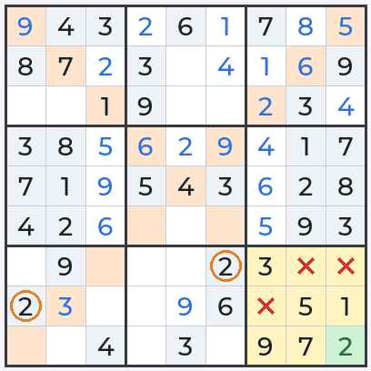

<!-- Written by tools/walkthrough.py x-sudoku: edit the script, not this page. -->
# X-Sudoku, step 23: the 2 in box 9

**Step 23 of 44** · [← Step 22](step-22.md) · [All steps](../x-sudoku.md#the-whole-puzzle-step-by-step) · [Step 24 →](step-24.md)

Box 9 needs a 2. r7c8 and r7c9: row 7 has one (r7c6). r8c7: row 8 has one (r8c1). Only **r9c9** is left: **r9c9 = 2**.

**Step 23 of 44** · [← Step 22](step-22.md) · [All steps](../x-sudoku.md#the-whole-puzzle-step-by-step) · [Step 24 →](step-24.md)
