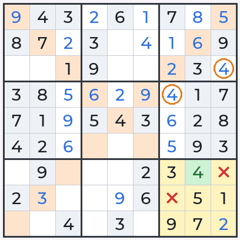

<!-- Written by tools/walkthrough.py x-sudoku: edit the script, not this page. -->
# X-Sudoku, step 24: the 4 in box 9

**Step 24 of 44** · [← Step 23](step-23.md) · [All steps](../x-sudoku.md#the-whole-puzzle-step-by-step) · [Step 25 →](step-25.md)

Box 9 needs a 4. r7c9: column 9 has one (r3c9). r8c7: column 7 has one (r4c7). Only **r7c8** is left: **r7c8 = 4**.

**Step 24 of 44** · [← Step 23](step-23.md) · [All steps](../x-sudoku.md#the-whole-puzzle-step-by-step) · [Step 25 →](step-25.md)
