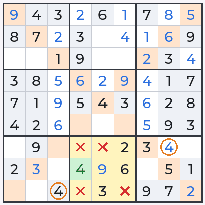

<!-- Written by tools/walkthrough.py x-sudoku: edit the script, not this page. -->
# X-Sudoku, step 25: the 4 in box 8

**Step 25 of 44** · [← Step 24](step-24.md) · [All steps](../x-sudoku.md#the-whole-puzzle-step-by-step) · [Step 26 →](step-26.md)

Box 8 needs a 4. r7c4 and r7c5: row 7 has one (r7c8). r9c4 and r9c6: row 9 has one (r9c3). Only **r8c4** is left: **r8c4 = 4**.

**Step 25 of 44** · [← Step 24](step-24.md) · [All steps](../x-sudoku.md#the-whole-puzzle-step-by-step) · [Step 26 →](step-26.md)
