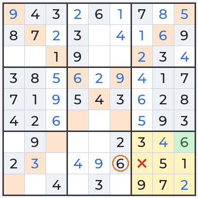

<!-- Written by tools/walkthrough.py x-sudoku: edit the script, not this page. -->
# X-Sudoku, step 26: the 6 in box 9

**Step 26 of 44** · [← Step 25](step-25.md) · [All steps](../x-sudoku.md#the-whole-puzzle-step-by-step) · [Step 27 →](step-27.md)

Box 9 needs a 6. r8c7: row 8 has one (r8c6). Only **r7c9** is left: **r7c9 = 6**.

**Step 26 of 44** · [← Step 25](step-25.md) · [All steps](../x-sudoku.md#the-whole-puzzle-step-by-step) · [Step 27 →](step-27.md)
