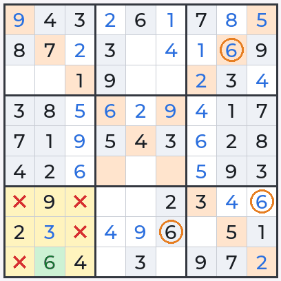

<!-- Written by tools/walkthrough.py x-sudoku: edit the script, not this page. -->
# X-Sudoku, step 27: the 6 in box 7

**Step 27 of 44** · [← Step 26](step-26.md) · [All steps](../x-sudoku.md#the-whole-puzzle-step-by-step) · [Step 28 →](step-28.md)

Box 7 needs a 6. r7c1 and r7c3: row 7 has one (r7c9). r8c3: row 8 has one (r8c6). r9c1: the anti-diagonal has one (r2c8). Only **r9c2** is left: **r9c2 = 6**.

**Step 27 of 44** · [← Step 26](step-26.md) · [All steps](../x-sudoku.md#the-whole-puzzle-step-by-step) · [Step 28 →](step-28.md)
