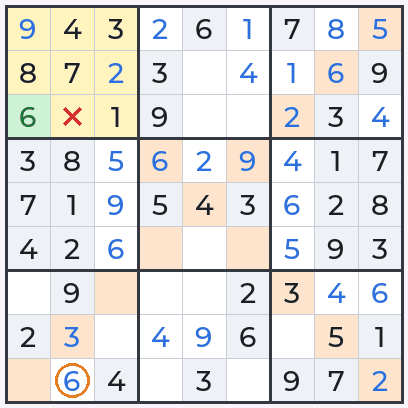

<!-- Written by tools/walkthrough.py x-sudoku: edit the script, not this page. -->
# X-Sudoku, step 28: the 6 in box 1

**Step 28 of 44** · [← Step 27](step-27.md) · [All steps](../x-sudoku.md#the-whole-puzzle-step-by-step) · [Step 29 →](step-29.md)

Box 1 needs a 6. r3c2: column 2 has one (r9c2). Only **r3c1** is left: **r3c1 = 6**.

**Step 28 of 44** · [← Step 27](step-27.md) · [All steps](../x-sudoku.md#the-whole-puzzle-step-by-step) · [Step 29 →](step-29.md)
