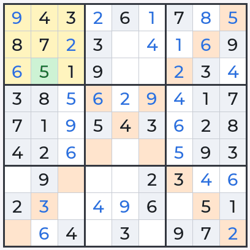

<!-- Written by tools/walkthrough.py x-sudoku: edit the script, not this page. -->
# X-Sudoku, step 29: the 5 in box 1

**Step 29 of 44** · [← Step 28](step-28.md) · [All steps](../x-sudoku.md#the-whole-puzzle-step-by-step) · [Step 30 →](step-30.md)

Box 1 needs a 5, and r3c2 is its last empty cell: **r3c2 = 5**.

**Step 29 of 44** · [← Step 28](step-28.md) · [All steps](../x-sudoku.md#the-whole-puzzle-step-by-step) · [Step 30 →](step-30.md)
