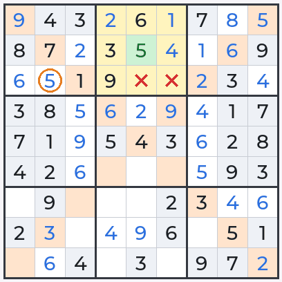

<!-- Written by tools/walkthrough.py x-sudoku: edit the script, not this page. -->
# X-Sudoku, step 30: the 5 in box 2

**Step 30 of 44** · [← Step 29](step-29.md) · [All steps](../x-sudoku.md#the-whole-puzzle-step-by-step) · [Step 31 →](step-31.md)

Box 2 needs a 5. r3c5 and r3c6: row 3 has one (r3c2). Only **r2c5** is left: **r2c5 = 5**.

**Step 30 of 44** · [← Step 29](step-29.md) · [All steps](../x-sudoku.md#the-whole-puzzle-step-by-step) · [Step 31 →](step-31.md)
