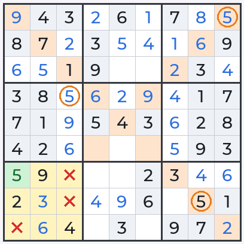

<!-- Written by tools/walkthrough.py x-sudoku: edit the script, not this page. -->
# X-Sudoku, step 31: the 5 in box 7

**Step 31 of 44** · [← Step 30](step-30.md) · [All steps](../x-sudoku.md#the-whole-puzzle-step-by-step) · [Step 32 →](step-32.md)

Box 7 needs a 5. r7c3: column 3 has one (r4c3). r8c3: row 8 has one (r8c8). r9c1: the anti-diagonal has one (r1c9). Only **r7c1** is left: **r7c1 = 5**.

**Step 31 of 44** · [← Step 30](step-30.md) · [All steps](../x-sudoku.md#the-whole-puzzle-step-by-step) · [Step 32 →](step-32.md)
