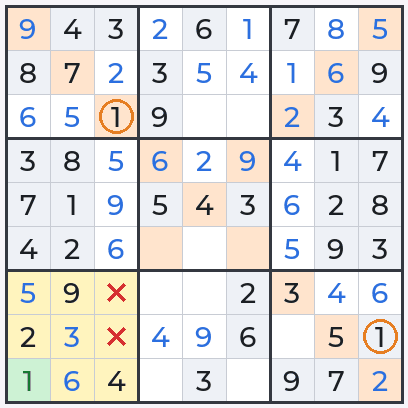

<!-- Written by tools/walkthrough.py x-sudoku: edit the script, not this page. -->
# X-Sudoku, step 32: the 1 in box 7

**Step 32 of 44** · [← Step 31](step-31.md) · [All steps](../x-sudoku.md#the-whole-puzzle-step-by-step) · [Step 33 →](step-33.md)

Box 7 needs a 1. r7c3: column 3 has one (r3c3). r8c3: row 8 has one (r8c9). Only **r9c1** is left: **r9c1 = 1**.

**Step 32 of 44** · [← Step 31](step-31.md) · [All steps](../x-sudoku.md#the-whole-puzzle-step-by-step) · [Step 33 →](step-33.md)
