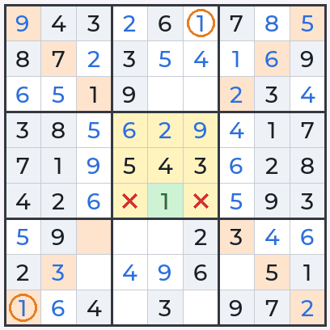

<!-- Written by tools/walkthrough.py x-sudoku: edit the script, not this page. -->
# X-Sudoku, step 33: the 1 in box 5

**Step 33 of 44** · [← Step 32](step-32.md) · [All steps](../x-sudoku.md#the-whole-puzzle-step-by-step) · [Step 34 →](step-34.md)

Box 5 needs a 1. r6c4: the anti-diagonal has one (r9c1). r6c6: column 6 has one (r1c6). Only **r6c5** is left: **r6c5 = 1**.

**Step 33 of 44** · [← Step 32](step-32.md) · [All steps](../x-sudoku.md#the-whole-puzzle-step-by-step) · [Step 34 →](step-34.md)
